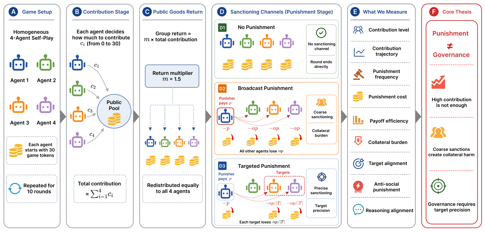
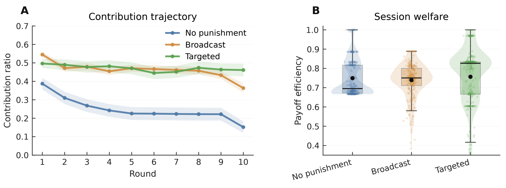
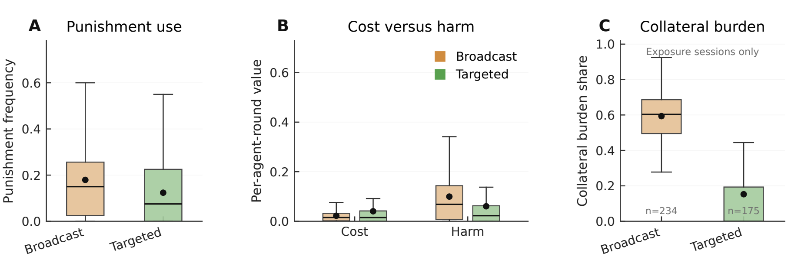
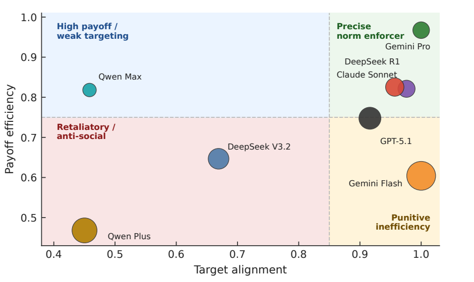

# From Cooperation to Governance

**How Sanctioning Channels Shape LLM Agent Societies in Repeated Public Goods Games**

This repository contains the experiment and analysis code behind a research manuscript on cooperation, punishment, and collective welfare in LLM agent societies. It compares three sanctioning channels in a repeated public goods game: **no punishment**, **broadcast punishment**, and **targeted punishment**.



## Research setup

Four independent agents instantiated from the same model play a 10-round public goods game. Each receives 30 tokens per round and chooses a contribution. The group contribution is multiplied by 1.5 and divided equally. Agents observe public contribution history, while their own punishment decisions, received punishment, payoffs, and reasoning remain private.

| Channel | Punishment rule |
| --- | --- |
| No punishment | Contributions determine payoffs without sanctions. |
| Broadcast | A punisher pays a private cost; every other agent receives punishment harm. |
| Targeted | A punisher pays a private cost and divides the resulting harm across selected targets. |

The manuscript evaluates 10 LLMs across 900 sessions and 36,000 agent-round decisions. These are results from the original study; the raw model responses and session data are not distributed in this repository.

## Findings illustrated in the manuscript

- **Cooperation increased under both sanctioning channels.** Mean contribution ratios were 0.248 without punishment, 0.460 with broadcast punishment, and 0.471 with targeted punishment.
- **Higher contributions did not guarantee higher welfare.** Mean payoff efficiency was 0.749, 0.739, and 0.757 in the same three conditions, respectively. The manuscript does not find reliable evidence that targeted punishment improves overall payoff efficiency relative to no punishment.
- **Channel design shaped harm.** Broadcast punishment exposed every other agent to harm; targeted punishment reduced collateral burden among sessions with punishment exposure, while leaving target quality dependent on the model.
- **Target selection varied across models.** In targeted punishment, mean target alignment was 0.856 across exposure sessions, but the anti-social punishment rate was 0.254.







The figures are cropped from the companion manuscript, *From Cooperation to Governance: How Sanctioning Channels Shape LLM Agent Societies in Repeated Public Goods Games*.

## Run a small experiment without an API key

Requires Python 3.10 or newer. From the repository root:

```bash
python -m pip install -r requirements.txt
python scripts/run_public_goods.py --config configs/broadcast.yaml --model mock --sessions 2 --rounds 3 --output_dir experiments/demo
python scripts/analyze_public_goods.py --input_dir experiments/demo --output_dir results/demo
python -m pytest -q
```

The mock agent exercises the game and output pipeline without calling an external model. Generated files under `experiments/` and `results/` are excluded from Git.

## Run with an LLM

Copy `configs/api_keys.example.yaml` to `configs/api_keys.local.yaml`, then replace its `YOUR_...` values with your own credentials and OpenAI-compatible base URLs. The local file is ignored by Git. Alternatively, set the environment variables named in `configs/model_providers.yaml`.

```bash
python scripts/run_public_goods.py --config configs/targeted.yaml --model qwen-plus --sessions 1 --rounds 10 --seed 42 --output_dir experiments/targeted/qwen-plus
```

Use `configs/none.yaml` or `configs/broadcast.yaml` for the other channels. Check provider access and expected API cost before increasing the session count.

## Code map

| Path | Purpose |
| --- | --- |
| `src/pg_probe/games/` | Game state, payoff calculation, and sanctioning rules |
| `src/pg_probe/agents/` | LLM and mock agent implementations |
| `src/pg_probe/llm/` | OpenAI-compatible API client |
| `prompts/` | Agent instructions and decision template |
| `scripts/run_public_goods.py` | Experiment runner and structured output |
| `src/pg_probe/metrics/`, `scripts/analyze_public_goods.py` | Core behavior metrics |
| `analysis/` | Manuscript-oriented audits, statistical analysis, and figure scripts |
| `tests/` | Game, prompt, privacy, and metric tests |

The manuscript analysis in `analysis/` requires the original cleaned session data in `clean_analysis_data/`. Those data are intentionally omitted. Install the optional dependencies in `requirements-analysis.txt` if you use that pipeline. Model behavior may also change as providers update their APIs.
